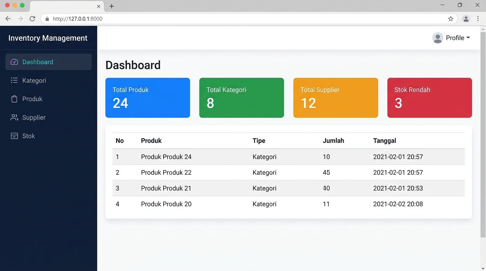
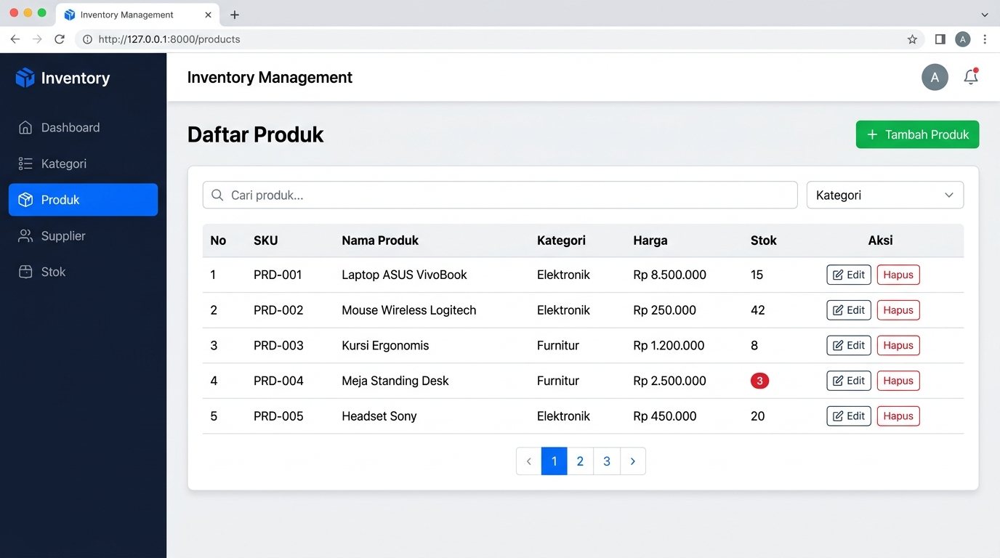
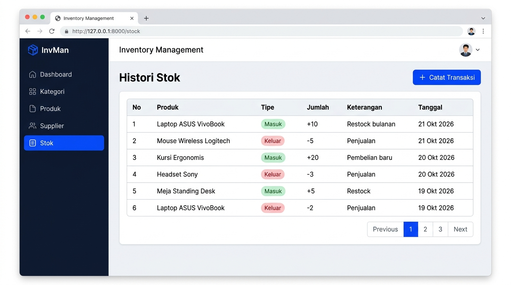

# 📦 Inventory Management System — Mini Project 4

Aplikasi manajemen inventaris berbasis **Laravel** dengan fitur CRUD lengkap untuk kategori, produk, supplier, dan pergerakan stok.

---

## 📸 Screenshots

### Dashboard


### Daftar Produk


### Histori Stok


---

## 🚀 Fitur Utama

- ✅ **Dashboard** — ringkasan data inventaris
- ✅ **Kategori** — tambah, edit, hapus kategori produk
- ✅ **Produk** — CRUD produk dengan SKU unik, harga, dan stok
- ✅ **Supplier** — manajemen data supplier (many-to-many dengan produk)
- ✅ **Stok** — pencatatan transaksi barang masuk/keluar dengan histori
- ✅ **Validasi** — SKU duplikat ditolak, stok keluar melebihi stok ditolak
- ✅ **Proteksi hapus** — kategori/produk dengan relasi aktif tidak bisa dihapus
- ✅ **Search, filter, sort & pagination**
- ✅ **Bootstrap 5** — tampilan responsif via CDN

---

## 🛠️ Teknologi

| Teknologi | Versi |
|-----------|-------|
| PHP | >= 8.2 |
| Laravel | 11 / 12 |
| MySQL | 5.7+ / 8.x |
| Bootstrap | 5 (CDN) |

---

## ⚙️ Cara Instalasi

### 1. Buat project Laravel baru
```bash
composer create-project laravel/laravel inventory-laravel
cd inventory-laravel
```

### 2. Salin file dari repository ini
Salin folder berikut ke dalam project Laravel:
```
app/Http/Controllers/
app/Models/
database/factories/
database/migrations/
database/seeders/
resources/views/
routes/web.php
```

### 3. Konfigurasi Bootstrap Pagination
Di `app/Providers/AppServiceProvider.php`, tambahkan di method `boot()`:
```php
\Illuminate\Pagination\Paginator::useBootstrapFive();
```

### 4. Buat database
Buka phpMyAdmin (XAMPP) → buat database baru:
```
Nama database: inventory_db
```

### 5. Konfigurasi `.env`
```env
APP_NAME=Inventory
DB_CONNECTION=mysql
DB_HOST=127.0.0.1
DB_PORT=3306
DB_DATABASE=inventory_db
DB_USERNAME=root
DB_PASSWORD=
```

> ⚠️ Jangan commit file `.env` ke repository publik!

### 6. Generate App Key
```bash
php artisan key:generate
```

### 7. Migrasi & Seeder
```bash
php artisan migrate:fresh --seed
```

### 8. Jalankan aplikasi
```bash
php artisan serve
```

Buka di browser: **http://127.0.0.1:8000**

---

## 📁 Struktur Project

```
Mini-project-4-/
├── screenshots/
│   ├── dashboard.jpg
│   ├── produk.jpg
│   └── stok.jpg
├── app/
│   ├── Http/Controllers/
│   │   ├── CategoryController.php
│   │   ├── DashboardController.php
│   │   ├── ProductController.php
│   │   ├── StockController.php
│   │   └── SupplierController.php
│   └── Models/
│       ├── Category.php
│       ├── Product.php
│       ├── StockMovement.php
│       └── Supplier.php
├── database/
│   ├── migrations/
│   ├── factories/
│   └── seeders/
├── resources/views/
│   ├── categories/
│   ├── products/
│   ├── suppliers/
│   ├── stock/
│   ├── layouts/
│   └── components/
├── routes/
│   └── web.php
└── README.md
```

---

## 🗺️ Routes

| Method | URL | Fungsi |
|--------|-----|--------|
| GET | `/` | Dashboard |
| GET/POST | `/categories` | List & tambah kategori |
| GET/PUT/DELETE | `/categories/{id}` | Edit & hapus kategori |
| GET/POST | `/products` | List & tambah produk |
| GET/PUT/DELETE | `/products/{id}` | Detail, edit & hapus produk |
| GET/POST | `/suppliers` | List & tambah supplier |
| GET/PUT/DELETE | `/suppliers/{id}` | Edit & hapus supplier |
| GET | `/stock` | Histori stok |
| GET/POST | `/stock/create` | Tambah transaksi stok |

---

## 🧪 Tabel Pengujian

| No | Pengujian | Hasil yang diharapkan | Status |
|----|-----------|-----------------------|--------|
| 1 | `php artisan serve` | Halaman dashboard terbuka | ⬜ |
| 2 | Koneksi DB via `.env` | Migration berjalan | ⬜ |
| 3 | `migrate:fresh --seed` | Tabel & data terisi | ⬜ |
| 4 | CRUD kategori | Tambah/edit/hapus berhasil | ⬜ |
| 5 | CRUD produk | Tambah/edit/hapus berhasil | ⬜ |
| 6 | CRUD supplier | Tambah/edit/hapus berhasil | ⬜ |
| 7 | SKU duplikat | Ditolak + pesan error | ⬜ |
| 8 | Hapus kategori yang dipakai produk | Ditolak | ⬜ |
| 9 | Barang masuk | Stok bertambah + histori tercatat | ⬜ |
| 10 | Barang keluar > stok | Ditolak, stok tidak berubah | ⬜ |

---

## ❗ Error Umum & Solusi

| Error | Solusi |
|-------|--------|
| `composer` tidak ditemukan | Install Composer & tambahkan PHP ke PATH |
| Versi PHP tidak kompatibel | Cek `php -v`, minimal PHP 8.2 |
| SQLSTATE connection refused | Pastikan MySQL XAMPP menyala & database sudah dibuat |
| No application encryption key | Jalankan `php artisan key:generate` |
| MassAssignmentException | Tambahkan kolom ke `$fillable` di model |
| Route not found / 404 | Cek `php artisan route:list` |
| View not found | Cek nama file di `resources/views/` |

---

## 👤 Author

**dewirikandi5**  
Mini Project 4 — Web Programming

---

> 💡 XAMPP hanya menjalankan MySQL. `php artisan serve` menjalankan aplikasi Laravel. Keduanya berjalan terpisah dan harus aktif bersamaan.
